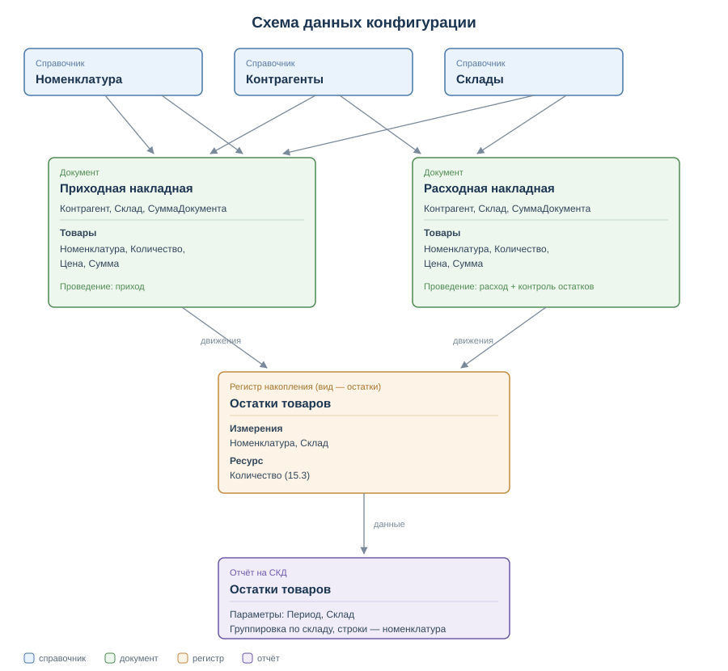

# test_1c_ai

Учебная конфигурация 1С:Предприятие 8 (проект 1C:EDT, платформа 8.5.1, режим совместимости 8.5.1, язык — русский).

## Состав

| Объект | Назначение |
| --- | --- |
| `Справочник.Номенклатура` | товары |
| `Справочник.Контрагенты` | поставщики и покупатели |
| `Справочник.Склады` | места хранения |
| `Документ.ПриходнаяНакладная` | поступление товаров, движения «Приход» |
| `Документ.РасходнаяНакладная` | списание товаров, движения «Расход», контроль остатков |
| `РегистрНакопления.ОстаткиТоваров` | остатки в разрезе номенклатуры и склада (вид — остатки) |
| `Отчет.ОстаткиТоваров` | отчёт на СКД по остаткам на дату, с отбором по складу |

## Схема данных

## Документация

Подробное описание выполненных действий, структуры объектов и результатов проверок —
в файле [ОПИСАНИЕ_ИЗМЕНЕНИЙ.md](ОПИСАНИЕ_ИЗМЕНЕНИЙ.md).
