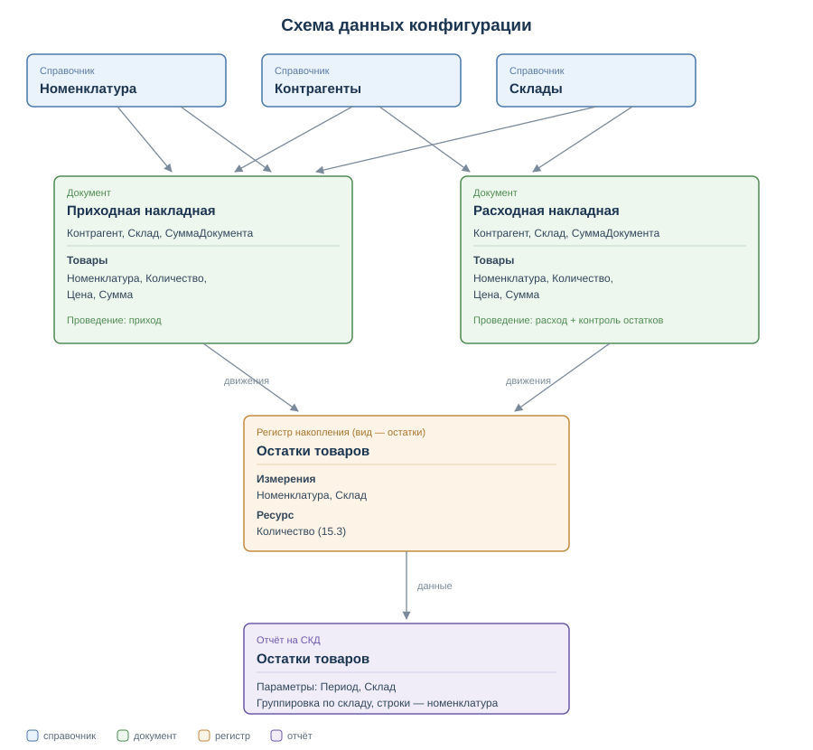

# Описание выполненных действий

Дата: 25.11.2025
Проект: `Конфигурация` (1C:EDT, платформа 8.5.1, режим совместимости 8.5.1, язык — русский)

## Схема данных

Исходник схемы — `docs/data-model.svg`.

## Задача

Создать в пустой конфигурации документ «Приходная накладная» с проведением по регистру
накопления, а также объекты метаданных, на которые документ ссылается.

## Что сделано

### 1. Справочники

| Объект | Представление списка |
| --- | --- |
| `Справочник.Номенклатура` | Номенклатура |
| `Справочник.Контрагенты` | Контрагенты |
| `Справочник.Склады` | Склады |

Все справочники созданы с реквизитами по умолчанию (`Код`, `Наименование`), без иерархии
и без владельцев.

### 2. Регистр накопления `ОстаткиТоваров`

- Вид регистра: **Остатки** (`registerType = Balance`).
- Измерения: `Номенклатура` (`СправочникСсылка.Номенклатура`), `Склад` (`СправочникСсылка.Склады`).
- Ресурс: `Количество` (`Число 15.3`).
- Регистратор: `Документ.ПриходнаяНакладная`.

### 3. Документ `ПриходнаяНакладная`

Реквизиты шапки:

| Реквизит | Тип |
| --- | --- |
| `Контрагент` | `СправочникСсылка.Контрагенты` |
| `Склад` | `СправочникСсылка.Склады` |
| `СуммаДокумента` | `Число 15.2` |
| `Комментарий` | `Строка` неограниченной длины, многострочный |

Табличная часть `Товары`:

| Реквизит | Тип |
| --- | --- |
| `Номенклатура` | `СправочникСсылка.Номенклатура` |
| `Количество` | `Число 15.3` |
| `Цена` | `Число 15.2` |
| `Сумма` | `Число 15.2` |

Стандартные реквизиты `Номер` и `Дата` используются как есть, новых реквизитов под
номер и дату документа не заводилось.

### 4. Модуль объекта документа

Файл: `src/Documents/ПриходнаяНакладная/ObjectModule.bsl`, область `ОбработчикиСобытий`.

- **`ОбработкаПроверкиЗаполнения`** — проверяет обязательность заполнения:
  контрагент, склад, непустая ТЧ `Товары`, заполненная номенклатура и количество > 0
  в каждой строке. Сообщения формируются через `СообщениеПользователю` с привязкой
  к конкретному полю (`Товары[<индекс>].<Реквизит>`), а не через `Сообщить`.
- **`ПередЗаписью`** — при `ОбменДанными.Загрузка = Истина` выходит без изменений;
  иначе пересчитывает `Сумма` в каждой строке (`Количество * Цена`) и итог в `СуммаДокумента`.
- **`ОбработкаПроведения`** — записывает движения по регистру `ОстаткиТоваров`
  видом движения «Приход»: период — дата документа, склад — из шапки,
  номенклатура и количество — из строк ТЧ.

## Проверки

| Проверка | Результат |
| --- | --- |
| Валидатор кода 1С (`syntax-checker`) | 0 ошибок, 0 предупреждений |
| Маркеры EDT по проекту | 0 ошибок |
| Остаточные предупреждения | 3 × SU47 «Метод доступен НаКлиенте» на обработчиках модуля объекта |

Предупреждения SU47 в модуле объекта — шум статической проверки: модуль объекта
исполняется только на сервере, директивы компиляции (`&НаСервере` и т. п.) в нём
неприменимы, поэтому «исправить» их нельзя.

Запуск в информационной базе **не выполнялся**: конфигурация не загружалась в ИБ,
проведение документа на реальных данных не проверялось.

## Что осталось за рамками задачи

- Формы документа (сейчас у документа нет собственных форм — используются
  автоматически генерируемые).
- Роли и права доступа.
- Печатная форма (макет).
- Подсистемы и командный интерфейс — объекты не включены ни в одну подсистему.
- Обработка `ОбработкаЗаполнения` (заполнение по основанию).

## Дополнение: документ `РасходнаяНакладная`

Добавлен по аналогии с `ПриходнаяНакладная`.

Реквизиты шапки: `Контрагент`, `Склад`, `СуммаДокумента` (15.2), `Комментарий`
(строка неограниченной длины, многострочный). Табличная часть `Товары`:
`Номенклатура`, `Количество` (15.3), `Цена` (15.2), `Сумма` (15.2).
Документ является регистратором `ОстаткиТоваров`.

Модуль объекта (`src/Documents/РасходнаяНакладная/ObjectModule.bsl`):

- **`ОбработкаПроверкиЗаполнения`**, **`ПередЗаписью`** — аналогично приходной накладной.
- **`ОбработкаПроведения`** — движения видом «Расход», затем контроль остатков.
- **`ЕстьНедостаточныеОстатки`** (служебная функция, область `СлужебныеПроцедурыИФункции`) —
  запросом получает остатки по складу документа на момент времени **до** записей текущего
  документа (`Новый Граница(МоментВремени(), ВидГраницы.Исключая)`), сравнивает с
  количеством из ТЧ, агрегированным по номенклатуре, и выводит сообщение по каждой
  позиции, которой не хватает. При нехватке проведение отменяется (`Отказ = Истина`).

Проверки: запрос контроля остатков — валидатор запросов EDT, 0 ошибок и предупреждений;
маркеры модуля — 0 ошибок (те же 4 × SU47 по обработчикам и служебной функции).
В информационной базе не запускалось.

## Дополнение: отчёт `ОстаткиТоваров`

Отчёт на системе компоновки данных (`Report.ОстаткиТоваров`, представление списка
«Остатки товаров»).

- Макет `ОсновнаяСхемаКомпоновкиДанных` (`DataCompositionSchema`) назначен главной схемой
  компоновки отчёта (`mainDataCompositionSchema`).
- Набор данных — запрос к `РегистрНакопления.ОстаткиТоваров.Остатки(&Период, Склад = &Склад)`:
  поля `Склад`, `Номенклатура`, `КоличествоОстаток`.
- Параметры СКД объявлены: `Период` (`Дата`, дата+время) и `Склад` (`СправочникСсылка.Склады`),
  оба без ограничения использования.
- Вариант настроек `Основной` («Остатки товаров»): выбранные поля `Склад`, `Номенклатура`,
  `КоличествоОстаток`; структура — группировка по `Складу`, внутри группировка по
  `Номенклатуре`.
- `КоличествоОстаток` объявлен **ресурсом** (`totalField`, выражение `Сумма(КоличествоОстаток)`),
  поэтому количество выводится как итог на каждом уровне группировки.
- Форма отчёта `Форма` сгенерирована штатно: реквизит `Результат` (`ТабличныйДокумент`),
  поле `Результат`, группа пользовательских настроек, стандартная команда «Сформировать».
  Собственный модуль формы не требуется.

Проверки: запрос схемы — валидатор EDT (QlDcsResource), 0 ошибок и предупреждений;
маркеры макета — 0. Запуск отчёта в информационной базе не выполнялся.

## Дополнение: формы документов

Для обоих документов созданы формы объекта (основная форма документа):

| Документ | Форма |
| --- | --- |
| `ПриходнаяНакладная` | `src/Documents/ПриходнаяНакладная/Forms/ФормаДокумента/Form.form` |
| `РасходнаяНакладная` | `src/Documents/РасходнаяНакладная/Forms/ФормаДокумента/Form.form` |

Формы сгенерированы штатным механизмом EDT (тип `OBJECT`) и назначены основными формами
документов. Состав элементов:

- реквизиты шапки: `Номер`, `Дата`, `Контрагент`, `Склад`, `СуммаДокумента`, `Комментарий`;
- табличная часть `Товары`: колонки `НомерСтроки`, `Номенклатура`, `Количество`, `Цена`, `Сумма`;
- автоматическая командная панель формы и командная панель таблицы.

Проверено по файлу формы: на форме и на каждом элементе заданы `<visible>true</visible>`
и `<enabled>true</enabled>` (без этого форма открывается недоступной для ввода).
Маркеры EDT по обеим формам — 0. Открытие формы в информационной базе не выполнялось.

